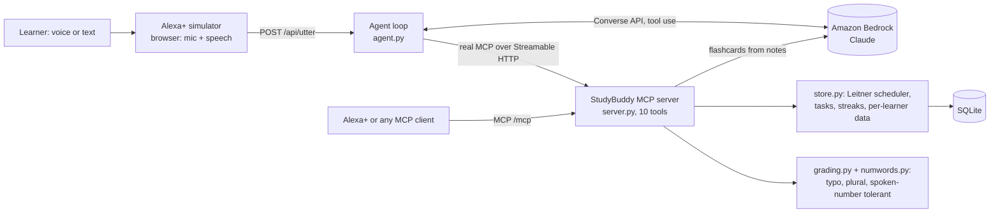

# StudyBuddy: an MCP server for Alexa+

**Demo video:** (link coming soon)  |  **Live server:** https://study-buddy-q49m.onrender.com

**NOTE:** Free hosting: the first load may take about a minute to wake up, and data resets on restart.
The public instance runs in offline keyword mode so it can't spend anyone's AWS credits.
The Amazon Bedrock agent and AI flashcards are shown in the demo video; anyone can enable them
by filling a `.env` file (see "Turn on the Amazon Bedrock agent").

StudyBuddy turns a voice assistant into a study partner that **remembers what you get wrong**. It quizzes
you with spaced repetition, turns your own notes into flashcards (with AI, via Amazon Bedrock, or offline),
builds revision plans, tracks study tasks and reports your progress. Every learner's data is separate.

It is a self-hosted **MCP server** (spec 2025-11-25, Streamable HTTP) built with the official Python SDK,
plus an **agentic Alexa+ simulator**: an LLM agent that discovers the server's tools over real MCP and
decides for itself which to call.

## Architecture



A real Alexa+ (or any MCP client) talks to `/mcp` directly. The simulator is a stand-in for Alexa+'s
reasoning: with Bedrock configured it is an LLM agent; without it, a keyword router keeps the demo working.
Either way, **every tool call travels over real MCP HTTP**, and you see each one live in the trace panel.

## Requirements

- Python 3.10 or newer, Git
- Optional: an AWS account with Amazon Bedrock model access (for the LLM agent and AI flashcards)

## Run it

```bash
git clone https://github.com/SiddhantShukla02/study-buddy.git
cd study-buddy
python -m venv .venv
source .venv/bin/activate        # Windows: .venv\Scripts\activate
pip install -r requirements.txt
python server.py
```

Poetry works too: `poetry install --no-root` then `poetry run python server.py`.

- MCP endpoint: `http://localhost:8000/mcp`
- Simulator: `http://localhost:8000/` (chat on the left, live MCP tool calls on the right; mic and speech buttons work in Chrome and Edge)
- Health: `http://localhost:8000/api/health`

Verify everything end to end (server must be running): `python selfcheck.py`

### Turn on the Amazon Bedrock agent (optional)

Settings live in a git-ignored `.env` file, so nothing secret is ever committed and each teammate keeps their own:

```bash
cp .env.example .env        # Windows PowerShell: copy .env.example .env
```

Edit `.env` and fill in:

```
BEDROCK_MODEL_ID=<inference profile ID from Bedrock > Infer > Inference profiles>
AWS_REGION=<the region where that profile works, e.g. ap-southeast-2>
AWS_BEARER_TOKEN_BEDROCK=<a Bedrock API key from Bedrock > API keys>
```

Check it with `python bedrock_check.py`, then run `python server.py`. The simulator badge switches from
"Keyword mode" to "LLM agent: Amazon Bedrock", and `generate_flashcards_from_notes` uses the model. If Bedrock
errors, everything falls back to offline mode. Real environment variables, if set, override the file.

### Configuration (all optional)

| Variable | Default | Meaning |
|----------|---------|---------|
| `PORT` | `8000` | Port to listen on |
| `STUDYBUDDY_DB` | `studybuddy.db` | SQLite file. `:memory:` for throwaway data |
| `STUDYBUDDY_REQUIRE_AUTH` | off | `1` makes `/mcp` reject requests with no `Authorization` or `X-User-Id` |
| `STUDYBUDDY_ALLOWED_HOSTS` | none | Comma-separated public hostnames; turns DNS-rebinding protection on |
| `STUDYBUDDY_DEFAULT_TZ` | `UTC` | Timezone for learners who never set one |
| `BEDROCK_MODEL_ID`, `AWS_REGION`, `AWS_BEARER_TOKEN_BEDROCK` | none | Enable Amazon Bedrock features (usually set in `.env`) |

## Connect a real MCP client (Alexa+ or any other)

Point the client at your server's `/mcp` URL (use a tunnel such as `cloudflared tunnel --url http://localhost:8000`
or the deployed URL). Send `Authorization: Bearer <token>` or `X-User-Id: <id>` so each learner gets their own
data, and optionally `X-Timezone: Asia/Kolkata`. Without an identity header, callers share one default learner.
`python demo_client.py <url>/mcp` shows exactly what a client sees.

## Tools

| Tool | What it does |
|------|--------------|
| `quiz_me(subject?)` | Asks one due question; often-missed cards come first |
| `check_answer(question_id, answer)` | Grades the answer (typos, plurals, spoken numbers) and schedules the next review |
| `add_flashcard(front, back, subject)` | Saves a flashcard from the learner's own notes |
| `generate_flashcards_from_notes(notes, subject, max_cards)` | Turns pasted notes into flashcards (Bedrock, or offline rules) |
| `study_summary()` | Streak, accuracy, cards due, weakest subjects |
| `plan_revision(subject, days, minutes_per_day)` | Day-by-day plan, each day saved as a task |
| `add_study_task`, `list_study_tasks`, `complete_study_task` | Task tracking |
| `set_timezone(timezone)` | Streaks and due dates follow the learner's own midnight |

Every result includes a `speech` field (what a voice assistant should say), and every tool carries a
title and read-only/write annotations.

### How the learning works

Each card sits in a Leitner box from 1 to 5. A correct answer moves it up a box, so it returns after 1, 2, 4, 8
or 16 days. A miss sends it back to box 1 and keeps it due today, so it returns in the same session until it
sticks. Re-answering a card that is not due yet cannot inflate its box.

### Built for speech

Speech-to-text output is messy, so the grader accepts "fifty six" for 56, "nineteen forty seven" for 1947,
"D N A" for DNA, "cells division" for "cell division", and one-word typos, but never near-miss numbers
(156 is not 56).

## Project layout

| File | Purpose |
|------|---------|
| `server.py` | MCP server: tools, simulator routes, optional auth gate, startup |
| `store.py` | SQLite storage and study logic (standard library only) |
| `grading.py`, `numwords.py` | Answer grading and spoken-number parsing (standard library only) |
| `agent.py`, `llm.py` | LLM agent loop and Amazon Bedrock Converse wrapper |
| `envfile.py`, `bedrock_check.py` | `.env` loader and a one-call Bedrock check |
| `notes.py` | Flashcards from notes (Bedrock, with an offline fallback) |
| `router.py`, `speech.py` | Keyword fallback router and spoken wording |
| `simulator.html` | The Alexa+ simulator page |
| `demo_client.py`, `selfcheck.py` | Real MCP client demo and end-to-end checks |
| `Dockerfile`, `render.yaml` | Deployment |
| `tests/` | Automated tests (also run by GitHub Actions) |

## Tests

```bash
pip install -r requirements-dev.txt
python -m pytest -v
```

`test_grading`, `test_numwords`, `test_store`, `test_notes` and `test_agent` use only the standard library
(Bedrock and MCP are faked). `test_server` checks the MCP wiring and needs the `mcp` package.

## Deploy

`Dockerfile` and `render.yaml` are included (Render Blueprint). On hosts with an ephemeral disk, data resets on
every redeploy unless `STUDYBUDDY_DB` points at a persistent volume. Set `STUDYBUDDY_ALLOWED_HOSTS` to your
public hostname in production.

## Known limits (honest list)

- **No OAuth / account linking.** Learners are told apart by header (`Authorization` or `X-User-Id`), hashed
  before use. There is no login, so do not store anything sensitive. `STUDYBUDDY_REQUIRE_AUTH=1` at least
  rejects anonymous callers.
- The simulator stands in for Alexa+; it is not Alexa+ itself.
- The offline flashcard extractor is deliberately simple ("X is Y" and "X: Y" sentences).
- The `mcp` package is pinned to `>=1.23,<2`, because version 2 renamed `FastMCP` and would break the imports.

## License

MIT, see `LICENSE`.
